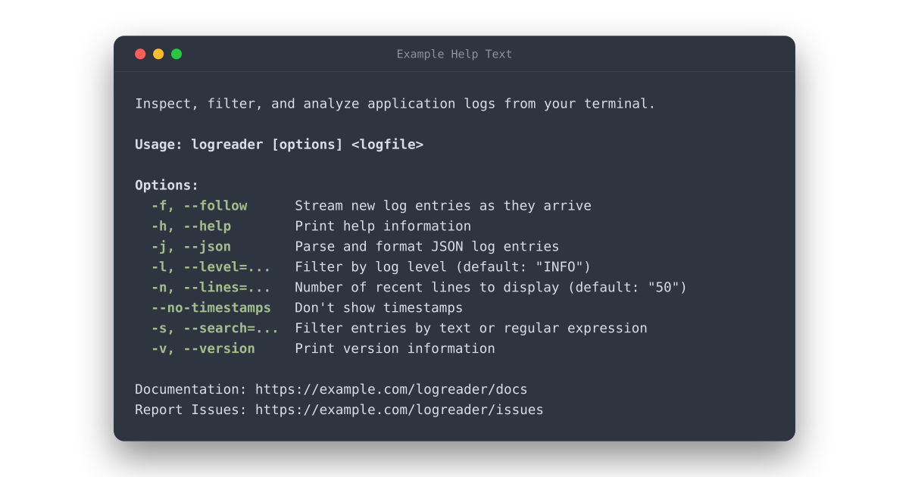

# `node-util-printhelp`

> Generate and print CLI help text from a Node.js [`util.parseArgs`][] configuration.

- Simple help text generation **without** introducing a **whole argument parser** to your project.
- **`node --help`-inspired** help text format, kept **simple** and **readable**.
- **Basic API** designed as a sibling function to [`util.parseArgs`][], re-using the same configuration.
- Adapts to terminal **width** and **styling capabilities**.

[][latest-release]
[][package-on-npm]
[][package-on-jsr]
[][package-on-bundlejs]



```ts
import { parseArgs, styleText } from "node:util";
import {
	type ParseArgsAndPrintHelpConfig,
	printHelp,
} from "node-util-printhelp";

// The same configuration can be passed to `parseArgs` and `printHelp`.
const config = {
	usage: [
		"logreader [options] [ application.log ]",
		"logreader ui [options] [ application.log ]",
	],
	header: "Inspect, filter, and analyze application logs from your terminal.",
	footer:
		"Documentation: https://example.com/logreader/docs\n" +
		"Report issues: https://example.com/logreader/issues",
	allowNegative: true,
	options: {
		follow: {
			type: "boolean",
			short: "f",
			description: "Stream new log entries as they arrive",
		},
		lines: {
			type: "string",
			default: "50",
			short: "n",
			description: "Number of recent lines to display",
		},
		search: {
			type: "string",
			short: "s",
			description: "Filter entries by text or regular expression",
		},
		timestamps: {
			type: "boolean",
			default: true,
			description: "Don't show timestamps",
		},
		json: {
			type: "boolean",
			short: "j",
			description: "Parse and format JSON log entries",
		},
		version: {
			type: "boolean",
			short: "v",
			description: "Print version information",
		},
		help: {
			type: "boolean",
			short: "h",
			description: "Print help information",
		},
	},
} as const satisfies ParseArgsAndPrintHelpConfig;

// Try to parse command-line arguments as configured.
let args;
try {
	args = parseArgs(config);
} catch (error: any) {
	if (
		error.code === "ERR_PARSE_ARGS_INVALID_OPTION_VALUE" ||
		error.code === "ERR_PARSE_ARGS_UNEXPECTED_POSITIONAL" ||
		error.code === "ERR_PARSE_ARGS_UNKNOWN_OPTION"
	) {
		// If CLI is used incorrectly, print error + help text and exit 1.
		const stream = process.stderr;
		stream.write(styleText("red", `Error: ${error.message}\n\n`, { stream }));
		printHelp(config, { stream });
		process.exit(1);
	}
	throw error;
}

if (args.values.help) {
	// If "-h/--help" argument is used, print help text and exit 0.
	printHelp(config);
	process.exit(0);
}
```

## Installation

The package supports Node.js `v22.13.0` and up, as well as `v23.5.0` and up,
and any other runtime that implements those Node.js APIs.

<details>

<summary><b>With pnpm</b></summary>

##### From [npmjs.com][]

```sh
pnpm add node-util-printhelp
```
```ts
import { printHelp } from "node-util-printhelp";
```

##### From [jsr.io][]

```sh
pnpm add jsr:@jonasgeiler/node-util-printhelp
# or (using pnpm 10.8 or older)
pnpm dlx jsr add @jonasgeiler/node-util-printhelp
```
```ts
import { printHelp } from "@jonasgeiler/node-util-printhelp";
```

</details>
<details>

<summary><b>With npm</b></summary>

##### From [npmjs.com][]

```sh
npm install node-util-printhelp
```
```ts
import { printHelp } from "node-util-printhelp";
```

##### From [jsr.io][]

```sh
npx jsr add @jonasgeiler/node-util-printhelp
```
```ts
import { printHelp } from "@jonasgeiler/node-util-printhelp";
```

</details>
<details>

<summary><b>With Yarn</b></summary>

##### From [npmjs.com][]

```sh
yarn add node-util-printhelp
```
```ts
import { printHelp } from "node-util-printhelp";
```

##### From [jsr.io][]

```sh
yarn add jsr:@jonasgeiler/node-util-printhelp
# or (using Yarn 4.8 or older)
yarn dlx jsr add @jonasgeiler/node-util-printhelp
```
```ts
import { printHelp } from "@jonasgeiler/node-util-printhelp";
```

</details>
<details>

<summary><b>With Bun</b></summary>

##### From [npmjs.com][]

```sh
bun add node-util-printhelp
```
```ts
import { printHelp } from "node-util-printhelp";
```

##### From [jsr.io][]

```sh
bunx jsr add @jonasgeiler/node-util-printhelp
```
```ts
import { printHelp } from "@jonasgeiler/node-util-printhelp";
```

</details>
<details>

<summary><b>With Deno</b></summary>

##### From [npmjs.com][]

```sh
bun add node-util-printhelp
```
```ts
import { printHelp } from "node-util-printhelp";
```

##### From [jsr.io][]

```sh
deno add jsr:@jonasgeiler/node-util-printhelp
```
```ts
import { printHelp } from "@jonasgeiler/node-util-printhelp";
```

##### From [jsr.io][] (direct import)

```ts
import { printHelp } from "jsr:@jonasgeiler/node-util-printhelp@^1.0.0";
```

</details>
<details>

<summary><b>With vlt</b></summary>

##### From [npmjs.com][]

```sh
vlt install node-util-printhelp
```
```ts
import { printHelp } from "node-util-printhelp";
```

##### From [jsr.io][]

```sh
vlt install jsr:@jonasgeiler/node-util-printhelp
```
```ts
import { printHelp } from "@jonasgeiler/node-util-printhelp";
```

</details>

## API

### `printHelp(config[, additionalOptions])`

- `config` [`<Object>`][] The configuration shared with [`util.parseArgs`][]. It accepts the standard `ParseArgsConfig` fields, plus some extra help-text properties described below.
  - `usage` [`<string>`][] | [`<string>`][][] A usage pattern or an array of usage patterns, printed after `Usage: ` on one or multiple lines. For example `"toolname [options] <input-file> <output-file>"`. **Default:** CLI name deduced from the running process + `" [options]"`
  - `header` [`<string>`][] Optional header text printed before the usage patterns.
  - `footer` [`<string>`][] Optional footer text printed after the list of options.
  - `options` [`<Object>`][] The options for [`util.parseArgs`][].
    - `description` [`<string>`][] An optional description printed beside the option. It is used only by `printHelp` and ignored by [`util.parseArgs`][].
- `additionalOptions` [`<Object>`][] Additional options exclusive to `printHelp`.
  - `stream` [`<stream.Writable>`][] The [TTY][] stream to which help text is written and which determines if text styling is used and how wide the output should be. **Default:** `process.stdout`

Prints formatted help text for a [`util.parseArgs`][] configuration.

The `options` item's `short`, `type`, and `default` fields control the displayed
option name and default value. String options are displayed with an `=...` value
placeholder. When `allowNegative` is enabled, boolean options with a default
of `true` are displayed using their `--no-` form and ignore their `short` alias.

The `header`, `footer`, and option's `description` are wrapped to fit the
given [TTY][] stream.

The `COLUMNS` environment variable takes precedence over the `stream.columns`
value when determining the output width.

## Project Scope

The API and feature set is purposefully kept simple and basic.
New features will be added only with much consideration, so that the
configuration stays close to Node.js's `util.parseArgs` function and the output
remains predictable.

If you need subcommands, advanced formatting/styling controls, multiple usage
text lines, or more, consider using a mature command-line parsing library or
framework, such as [`yargs`][], [`commander.js`][] or [`oclif`][].

[`util.parseArgs`]: https://nodejs.org/api/util.html#utilparseargsconfig
[`WriteStream`]: https://nodejs.org/api/tty.html#class-ttywritestream
[help implementation]: https://github.com/nodejs/node/blob/main/lib/internal/main/print_help.js
[npmjs.com]: https://www.npmjs.com/
[jsr.io]: https://jsr.io/
[`<Object>`]: https://developer.mozilla.org/docs/Web/JavaScript/Reference/Global_Objects/Object
[`<string>`]: https://developer.mozilla.org/docs/Web/JavaScript/Data_structures#string_type
[`<stream.Writable>`]: https://nodejs.org/api/stream.html#class-streamwritable
[TTY]: https://nodejs.org/api/tty.html
[`yargs`]: https://yargs.js.org/
[`commander.js`]: https://github.com/tj/commander.js
[`oclif`]: https://oclif.io/
[latest-release]: https://github.com/jonasgeiler/node-util-printhelp/releases/latest
[package-on-bundlejs]: https://bundlejs.com/?q=node-util-printhelp
[package-on-jsr]: https://jsr.io/@jonasgeiler/node-util-printhelp
[package-on-npm]: https://www.npmjs.com/package/node-util-printhelp
